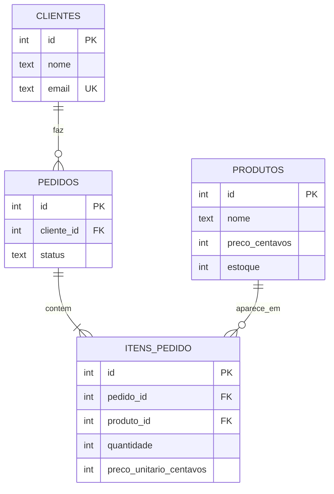

# API de Pedidos

API RESTful em **Python** (FastAPI) com banco **SQL** (SQLite) para gerenciar clientes, produtos e pedidos. O projeto simula uma entrega típica de estágio em desenvolvimento back-end: modelagem do banco, consultas SQL escritas à mão, endpoints REST com validação, tratamento de erros, testes automatizados e versionamento com Git.

## O que a API faz

- Cadastro, consulta, edição e remoção de **clientes** e **produtos** (CRUD).
- Criação de **pedidos** com vários itens. O sistema baixa o estoque, guarda o preço da hora da compra e calcula o total.
- **Status do pedido** com regras: `pendente` → `pago` → `enviado`, e cancelamento permitido enquanto o pedido ainda não foi enviado. Cancelar devolve o estoque.
- **Relatórios** com SQL agregado: vendas por produto e clientes que mais gastaram.
- Paginação, busca e filtros nas listagens.

## Tecnologias

| Item | Uso |
| --- | --- |
| Python 3.10+ | Linguagem |
| FastAPI | Framework da API REST e documentação automática (Swagger) |
| SQLite + `sqlite3` | Banco SQL; as consultas são escritas em SQL puro, sem ORM |
| Pydantic | Validação dos dados de entrada e saída (JSON) |
| pytest + httpx | Testes automatizados dos endpoints |
| Git | Versionamento, com commits por etapa |

## Como rodar

```bash
# 1. Crie e ative um ambiente virtual
python -m venv .venv
source .venv/bin/activate        # no Windows: .venv\Scripts\activate

# 2. Instale as dependências
pip install -r requirements.txt

# 3. Suba a API com os dados de demonstração
SEED_DEMO=1 uvicorn app.main:app --reload       # no Windows (PowerShell): $env:SEED_DEMO=1; uvicorn app.main:app --reload
```

A API fica em `http://127.0.0.1:8000`. A documentação interativa (Swagger) fica em `http://127.0.0.1:8000/docs`, onde dá para testar cada endpoint.

O banco é o arquivo `estagio.db`, criado na primeira execução. Para usar outro caminho, defina `DATABASE_PATH`. Para criar o banco sem subir a API: `python -m app.init_db --demo`.

## Endpoints

| Método | Rota | Descrição |
| --- | --- | --- |
| GET | `/health` | Verifica se a API está no ar |
| POST | `/clientes` | Cria um cliente (e-mail único) |
| GET | `/clientes?limite=20&deslocamento=0` | Lista com paginação |
| GET | `/clientes/{id}` | Busca um cliente |
| PUT | `/clientes/{id}` | Atualiza um cliente |
| DELETE | `/clientes/{id}` | Remove (409 se tiver pedidos) |
| POST | `/produtos` | Cria um produto |
| GET | `/produtos?busca=teclado&apenas_com_estoque=true` | Lista com busca e filtro |
| GET | `/produtos/{id}` | Busca um produto |
| PUT | `/produtos/{id}` | Atualiza um produto |
| DELETE | `/produtos/{id}` | Remove (409 se estiver em pedidos) |
| POST | `/pedidos` | Cria um pedido com itens |
| GET | `/pedidos?cliente_id=1&status=pago` | Lista com filtros |
| GET | `/pedidos/{id}` | Busca um pedido com seus itens |
| PATCH | `/pedidos/{id}/status` | Muda o status |
| GET | `/relatorios/vendas-por-produto` | Unidades e receita por produto |
| GET | `/relatorios/clientes-top?limite=5` | Clientes que mais gastaram |

Códigos de resposta usados: `200`, `201` (com cabeçalho `Location`), `204`, `404` (não encontrado), `409` (conflito com o estado atual, como estoque insuficiente), `422` (dados inválidos).

## Exemplos

Criar um cliente:

```bash
curl -X POST http://127.0.0.1:8000/clientes \
  -H "Content-Type: application/json" \
  -d '{"nome": "Ana Souza", "email": "ana@exemplo.com"}'
```

Criar um pedido (preços em centavos; o total sai em centavos):

```bash
curl -X POST http://127.0.0.1:8000/pedidos \
  -H "Content-Type: application/json" \
  -d '{"cliente_id": 1, "itens": [{"produto_id": 2, "quantidade": 3}]}'
```

Resposta:

```json
{
  "id": 4,
  "cliente_id": 1,
  "status": "pendente",
  "criado_em": "2026-11-24 14:30:00",
  "total_centavos": 26970,
  "itens": [
    {
      "produto_id": 2,
      "produto_nome": "Mouse sem fio",
      "quantidade": 3,
      "preco_unitario_centavos": 8990,
      "subtotal_centavos": 26970
    }
  ]
}
```

Marcar como pago:

```bash
curl -X PATCH http://127.0.0.1:8000/pedidos/4/status \
  -H "Content-Type: application/json" \
  -d '{"status": "pago"}'
```

## Modelo de dados



O esquema está em [`sql/schema.sql`](sql/schema.sql), com chaves estrangeiras, restrições `CHECK` e índices. As consultas dos relatórios (JOIN, GROUP BY, SUM) estão comentadas em [`sql/consultas.sql`](sql/consultas.sql).

## Decisões de projeto

- **Dinheiro em centavos (inteiro).** Evita erros de arredondamento de números decimais.
- **Preço copiado para o item do pedido.** Mudar o preço de um produto não altera pedidos antigos.
- **Transações.** Criar e cancelar pedido mexem em várias tabelas; se qualquer passo falhar, tudo é desfeito.
- **Baixa de estoque atômica.** `UPDATE ... WHERE estoque >= quantidade` confere e baixa numa única instrução, sem corrida entre duas compras.
- **SQL com parâmetros.** Todo valor vindo do usuário vai como parâmetro (`?`), nunca concatenado, para evitar SQL injection.
- **Camadas separadas.** `routers/` recebem a requisição, `repo_*.py` falam com o banco, `schemas.py` valida os dados e `errors.py` define erros de negócio traduzidos em HTTP.

## Testes

```bash
pytest
```

Os testes (`tests/test_api.py`) usam um banco temporário novo a cada teste e cobrem: validação, e-mail duplicado, paginação, filtros, cálculo do total, baixa e devolução de estoque, reversão quando um item do pedido falha, transições de status e relatórios.

## Estrutura

```
app/
  main.py            # aplicação e tratamento de erros
  database.py        # conexão e criação do banco
  schemas.py         # validação (Pydantic)
  repo_*.py          # SQL de clientes, produtos, pedidos e relatórios
  routers/           # endpoints REST
sql/                 # schema, dados de demonstração e consultas
tests/               # testes automatizados
```

## Próximos passos

- Autenticação (por exemplo, JWT) e perfis de acesso.
- Migrações de banco versionadas.
- Trocar o SQLite por PostgreSQL e rodar tudo com Docker.
- Integração contínua rodando os testes a cada push.
